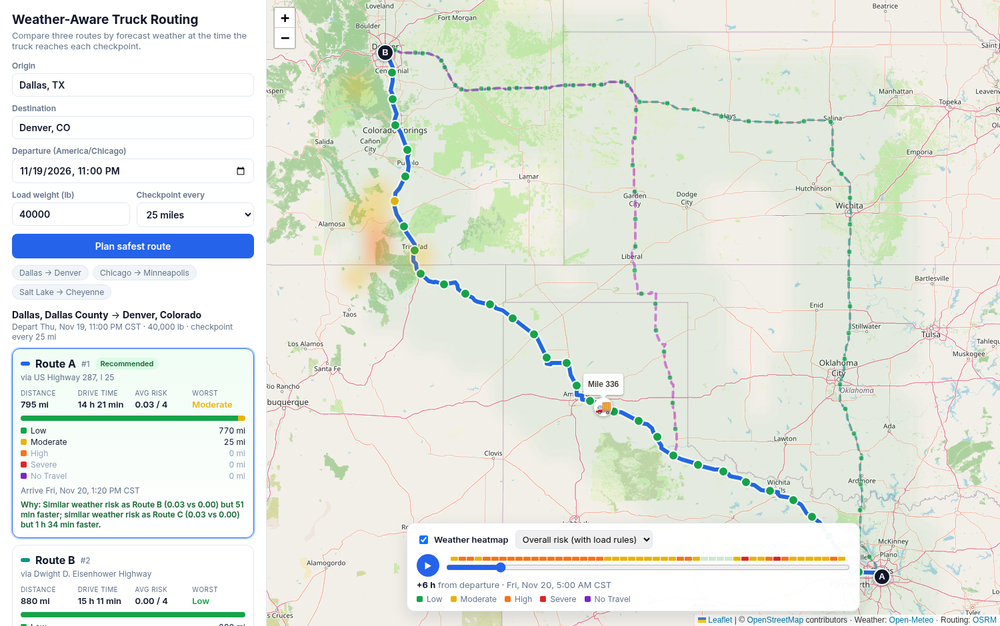

# Weather-Aware Truck Routing

A React + Django app that helps a truck driver pick the safest route. It compares three
route options using the forecast weather at the time the truck is expected to reach each
checkpoint, and applies the brief's wind, rain, snow and load-weight rules.



## What it does

1. The driver enters an origin, a destination, a departure date/time, the load weight (lb)
   and a checkpoint spacing (10, 25 or 50 miles; the default is 25).
2. The backend geocodes both places and fetches **3 route options**.
3. Each route is sampled every N miles. The **ETA at every checkpoint** comes from the
   routing engine's per-segment travel times, not a straight-line average.
4. The hourly forecast for each checkpoint is read for **the hour the truck arrives there**.
5. Each checkpoint gets a risk level: the worst of wind (after load rules), rain and snow.
6. Each route is summarised as miles per risk level plus a distance-weighted average risk,
   then ranked. The app recommends the best route and explains why.
7. The map shows every route, colour-coded checkpoints with popups, and a **weather heatmap
   along the trip corridor** with a **0–48 hour slider** (plus play/pause). A truck marker
   shows where the selected route puts the truck at the slider's hour.

## Running locally

Requirements: Python 3.11+ and Node 20+. No API keys are needed.

```bash
# Backend (http://127.0.0.1:8000)
cd backend
python -m venv .venv && source .venv/bin/activate
pip install -r requirements-dev.txt
python manage.py runserver

# Frontend (http://localhost:5173, proxies /api to Django)
cd frontend
npm install
npm run dev
```

Tests:

```bash
cd backend && pytest          # risk rules, ranking, geometry, API (upstreams mocked)
cd frontend && npm run build  # type-check + production build
```

Production-style run (one process serves the API and the built frontend):

```bash
cd frontend && npm run build
cd ../backend && DJANGO_DEBUG=false DJANGO_SECRET_KEY=change-me \
  gunicorn config.wsgi:application --bind 0.0.0.0:8000 --workers 2 --threads 4
```

## Deployment

The repo deploys as **one web service**: Django serves the API under `/api/` and, through
WhiteNoise, the built React app at `/`.

* `Dockerfile`: a multi-stage build (Node builds `frontend/dist`, then a Python image runs gunicorn).
* `render.yaml`: a Render Blueprint for a free Docker web service. Connect the GitHub repo
  in Render, choose **New → Blueprint**, and it builds from the Dockerfile.

Environment variables (all optional except the secret key in production):

| Variable | Default | Purpose |
|---|---|---|
| `DJANGO_SECRET_KEY` | dev key | Required when `DJANGO_DEBUG=false` |
| `DJANGO_DEBUG` | `true` | Set `false` in production |
| `DJANGO_ALLOWED_HOSTS` | `*` | Comma-separated hosts |
| `CORS_ALLOWED_ORIGINS` | `http://localhost:5173` | Only needed if the frontend is hosted on another domain |
| `VITE_API_BASE` (build time) | empty (same origin) | API URL when the frontend is hosted separately |
| `CACHE_DIR` | `backend/.cache` | File cache location |
| `OSRM_URL`, `NOMINATIM_URL`, `PHOTON_URL`, `OPEN_METEO_URL` | public endpoints | Point to self-hosted instances if needed |

## Architecture

```
frontend/ (React 19 + Vite + TypeScript + react-leaflet)
  src/App.tsx                 state: plan, selected route, heatmap, slider hour
  src/components/TripForm     inputs + examples
  src/components/MapView      routes, checkpoint markers + popups, heat overlay, truck marker
  src/components/RouteCards   distance, time, miles by risk, avg risk, why recommended
  src/components/HeatControls metric picker, 0-48 h slider, play/pause, per-hour peak strip, legend
  src/lib/heatFrames.ts       renders all 49 heatmap frames to images once
  src/lib/risk.ts             colours + thresholds (mirrors the backend)

backend/ (Django 6 + Django REST Framework)
  routing/views.py            POST /api/plan/, GET /api/heatmap/<plan_id>/, GET /api/health/
  routing/services/
    geocoding.py              Nominatim, with Photon as a fallback; also accepts "lat,lng"
    routing_api.py            OSRM routes + via-point alternatives + spur trimming
    geo.py                    haversine, timed polyline (distance + ETA per vertex), sampling, RDP
    weather.py                Open-Meteo batched hourly forecasts + unit conversion
    risk.py                   pure risk classification, route summary, ranking, explanation
    planner.py                orchestrates one trip plan
    heatmap.py                corridor grid + 48 h forecast for the heatmap
    http.py                   cached GET with retries and per-host rate limiting
```

### API

`POST /api/plan/`

```json
{ "origin": "Dallas, TX", "destination": "Denver, CO",
  "departure": "2026-11-21T08:00:00-06:00", "load_lb": 40000, "interval_mi": 25 }
```

This returns the geocoded endpoints, then for each route: geometry, distance, duration,
arrival, a checkpoint list (mile, position, ETA, weather, per-condition risk, overall risk,
risk drivers), a summary (miles by risk level, average and max risk), its rank,
`recommended` and `recommendation_reason`. It also returns a `plan_id` and any warnings.

`GET /api/heatmap/<plan_id>/` returns the corridor grid (Mercator-aligned bounds, `nx`, `ny`),
the 49 hourly timestamps, and for each cell the hourly wind, rain, snow and overall risk
(with load rules).

The heatmap is a separate request, so the routes appear first and the heavier forecast
grid loads in the background.

## API choices (all free, no keys)

| Need | Service | Why |
|---|---|---|
| Geocoding | **Nominatim** (OSM), with **Photon** as a fallback | Free and keyless; requests are rate-limited to Nominatim's 1 request/second policy and sent with a proper User-Agent |
| Routing | **OSRM** public server (`alternatives=3`, `annotations=duration`) | Keyless, fast, and gives per-segment durations for accurate checkpoint ETAs |
| Weather | **Open-Meteo** forecast API | Keyless and hourly up to 16 days ahead; it accepts many coordinates per request, so one call covers ~100 checkpoints |
| Map tiles | CARTO Voyager (OpenStreetMap data) | Free, keyless basemap with attribution; the OSM tile server blocks production apps that use it as a CDN |

**Caching.** Every upstream GET goes through a Django file cache, which is shared by
gunicorn workers. Lifetimes are geocodes 30 days, routes 24 h and forecasts 1 h. Heatmaps
are cached for 1 h and plans for 6 h. Coordinates are rounded to 0.01° (~1 km, finer than
the forecast models) to improve cache hits, and duplicate points are fetched once.

### Getting three routes

OSRM often returns only one or two alternatives on long trips. When that happens, the
backend asks OSRM for extra routes forced through a via-point offset to the left or right
of the fastest route's midpoint (15% or 28% of the trip length, plus off-centre variants).
A candidate is kept only when it:

* shares at most 80% of its road with the routes already chosen (checked with a coarse spatial hash), and
* is at most 60% slower than the fastest route.

If the nearest road to a via-point is a side road, OSRM drives in and back out. These
out-and-back spurs are detected and cut out, together with their drive time, so the
alternatives are real through-routes.

## Risk logic

Thresholds from the brief. Bands are half-open, so every value maps to exactly one level:

| Condition | Low | Moderate | High | Severe | No Travel |
|---|---|---|---|---|---|
| Wind (mph) | < 25 | 25 – < 35 | 35 – < 45 | 45 – < 55 | **≥ 55** |
| Rain (in/hr) | < 0.10 | 0.10 – < 0.25 | 0.25 – < 0.50 | 0.50 – 1.00 | **> 1.00** |
| Snow (in/hr) | < 0.5 | 0.5 – < 1.0 | 1.0 – < 2.0 | 2.0 – 3.0 | **> 3.0** |

**Load rules** apply to the wind level:

* wind ≥ 55 mph → No Travel, whatever the load
* 45–54 mph and load > 30,000 lb → No Travel
* 35–44 mph and load > 40,000 lb → Severe

**Checkpoint risk** is the maximum of wind (after load rules), rain and snow. The popup
lists which condition(s) drove the level.

**Route miles per level.** Each checkpoint covers the road halfway to its neighbours, so
the miles always add up to the route length (the shorter last segment is weighted
correctly). **Average risk** is the distance-weighted mean on a 0–4 scale (Low = 0 …
No Travel = 4).

**Ranking** follows the brief's order, with No Travel ranked below Severe:

1. fewest **No Travel** miles. A route through No Travel conditions is flagged and never
   preferred over one that avoids them.
2. fewest **Severe** miles
3. fewest **High** miles
4. lowest **average risk**
5. shortest **travel time**

To *balance risk against time*, average-risk differences of **0.05 or less** (on the 0–4
scale) count as equal, so travel time decides. Miles in Severe or High conditions are
never traded for time. The tolerance is one constant (`AVG_RISK_TOLERANCE` in `risk.py`),
and setting it to `0` gives a strict lexicographic order.

The recommended card explains the deciding criterion against each other route, for
example *"Fewer Severe miles than Route B (0 vs 40 mi); similar weather risk as Route C
(0.12 vs 0.10) but 1 h 05 min faster."*

## Heatmap

* The backend builds a grid over the bounding box of all routes. The grid is spaced evenly
  in Web-Mercator, about 32 cells on the long side and at least 0.15° per cell. It keeps
  only cells within **60 miles of any route** (the trip corridor), up to 600 cells.
* Open-Meteo is called once (batched) for hours 0–48 from departure. The response holds
  every hour, so **the slider never refetches**.
* The browser renders each of the 49 hours to a small PNG, then upscales it with
  smoothing. The images are built once per metric. Moving the slider only swaps the image
  source on one `ImageOverlay`, which takes about 5 ms per step in headless Chrome. The
  route layers are memoised and don't re-render.
* The metrics are **overall risk** (with load rules), wind, rain and snow. Colour stops
  sit on the risk thresholds, so a colour means the same thing in every view.

## Assumptions and limits

* **Travel time** is OSRM's car-profile estimate. Trucks are usually slower, and mandatory
  rest breaks (HOS) aren't modelled. ETAs, and so the forecast hour used, assume
  continuous driving.
* **Wind** uses sustained 10 m wind speed, as in the brief. Gusts are shown in popups for
  context but don't change the level.
* **Rain** is Open-Meteo `rain + showers` (mm/h ÷ 25.4). **Snow** is `snowfall`
  (cm/h ÷ 2.54). Hourly values are totals for the preceding hour, which is a per-hour rate.
* The forecast hour is the ETA rounded to the nearest hour (UTC).
* Forecasts reach about 15 days ahead, so departures outside that window are rejected
  with a clear message. Checkpoints without forecast data count as Low and are flagged on
  the route card.
* The public OSRM, Nominatim and Open-Meteo services have fair-use limits. Caching and
  batching keep a typical plan to about 3–8 routing calls, 2 geocodes and 2–4 weather
  calls (plus about 6 for the heatmap). For heavy use, point the `*_URL` settings at
  self-hosted or paid instances.
* Coverage is the US, Canada and Mexico (geocoding is restricted to those countries to
  avoid ambiguous matches).
